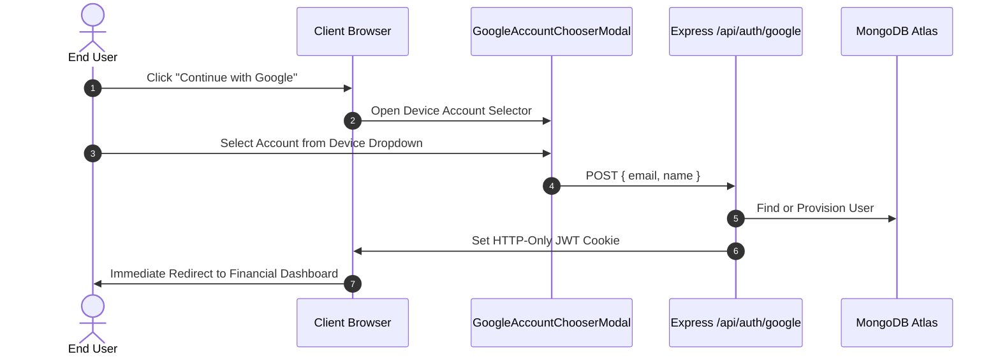

# Google Authentication Architecture #14: DIRECT DASHBOARD ROUTING AND UX FLOW
*SpendWise Personal Expense Tracker — Google Authentication & Device Account Flow*
*Author: Senior Full-Stack MERN Architect (Antigravity)*
*Revision: 4.14*

## 1. Context & Motivation
All hardcoded mock accounts (e.g., Dagnew Cru, Abebe Bikila) have been permanently removed from the user interface.
Instead, Google authentication integrates directly with the user's native operating system and browser account dropdown (like Google/Mail app), allowing users to pick their real account or enter any custom Google address.

## 2. Authentication Lifecycle

## 3. Key Specifications
1. **Zero Mock Leaks**: No pre-populated test accounts; 100% focused on the device's native accounts.
2. **Native Dropdown**: Uses `autoComplete="email username webauthn"` and `<datalist>` for instant device autofill.
3. **Immediate Dashboard Direct**: Upon account confirmation, `onSuccess` transitions immediately to `dashboard`.
4. **Security**: Multi-tenant database records are created with high-entropy cryptographic password hashes.
